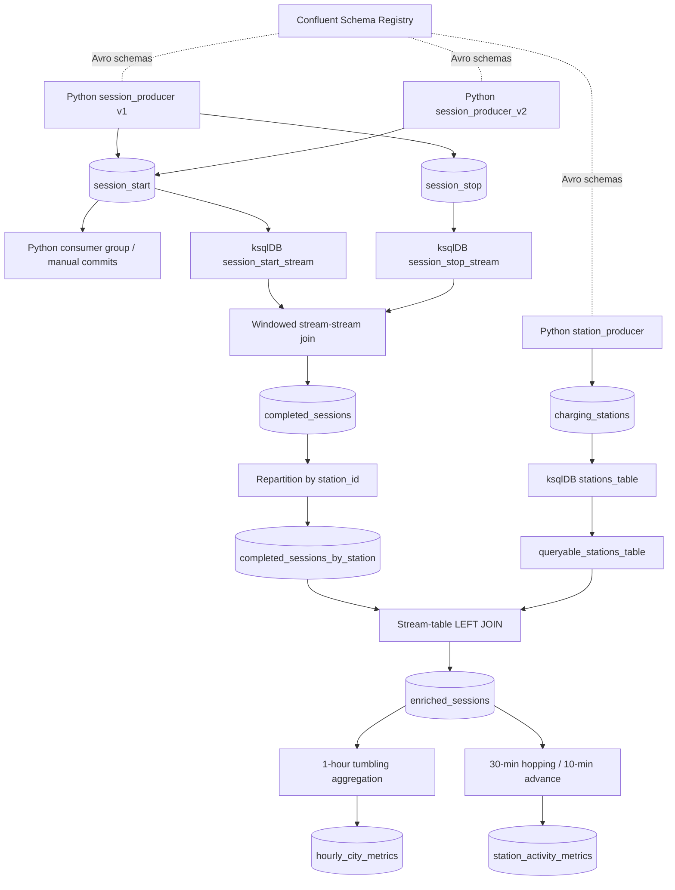

# Real-Time EV Charging Data Pipeline

An event-driven data engineering project using **Confluent Cloud Apache Kafka**, **Python**, **Avro / Schema Registry**, and **ksqlDB**. The pipeline generates charging-station reference data and charging-session events, demonstrates schema evolution and consumer-group behavior, and produces enriched and windowed analytics.

## Architecture



The diagram shows logical ksqlDB objects; persistent `CREATE ... AS SELECT` statements also create backing Kafka topics, whose generated names may differ from the SQL object names.

## Repository layout

```text
.
├── README.md
├── .python-version
├── pyproject.toml
├── uv.lock
├── config/
│   └── kafka_config.py
├── producers/
│   ├── station_producer.py
│   ├── session_producer.py
│   └── session_producer_v2.py
├── consumers/
│   ├── consumer.py
│   └── group_consumer.py
├── schemas/
│   ├── charging_stations.avsc
│   ├── session_start_v1.avsc
│   ├── session_start_v2.avsc
│   └── session_stop.avsc
├── scripts/
│   └── register_schema_v2.py
└── ksqldb/
    ├── README.md
    ├── 01_create_sources.sql
    ├── 02_completed_sessions.sql
    ├── 03_enriched_sessions.sql
    └── 04_windowed_aggregations.sql
```

## Requirements and setup

- Python **3.11** (the environment used for development)
- [`uv`](https://docs.astral.sh/uv/)
- Confluent Cloud Kafka cluster and API credentials
- Confluent Schema Registry and API credentials
- A ksqlDB cluster for Part E

```bash
uv sync
uv run python --version
```

Configure Kafka and Schema Registry credentials as expected by `config/kafka_config.py`. **Do not commit API keys, secrets, or credential-bearing configuration files.** The exact configuration variable names must be checked against your local `config/kafka_config.py` before sharing setup instructions publicly.

## Kafka topic design

| Topic | Purpose | Key | Partitions | Retention / cleanup |
|---|---|---|---:|---|
| `charging_stations` | Station reference data | `station_id` | 6 | Compaction-oriented reference data |
| `session_start` | Charging start events | `session_id` | 6 | Delete retention |
| `session_stop` | Charging stop events | `session_id` | 6 | Delete retention |

All event values use Avro schemas registered in Schema Registry. Session start and stop topics share `session_id` as a logical correlation key. For the stream-table join, completed sessions are explicitly repartitioned by `station_id`.

**Retention note:** A delete-retention topic can lose older events after its configured retention period. During testing, expired `session_stop` records had to be regenerated. Verify the current topic settings in Confluent Cloud rather than assuming the original records remain available.

## Produce test data

From the repository root:

```bash
uv run python -m producers.station_producer
uv run python -m producers.session_producer
```

The session producer generates **500 starts**, **462 stops**, and **38 intentionally unmatched starts** with a deterministic random seed. It flushes both producers and checks for delivery failures. It sends a finite test batch rather than running continuously.

### Schema evolution (Part C)

`session_start_v2.avsc` adds `payment_method` with an Avro default of `UNKNOWN` to support backward-compatible reading of older records.

```bash
uv run python -m scripts.register_schema_v2
uv run python -m producers.session_producer_v2
```

The v2 producer publishes 10 additional start records. Consumer tests use a v1 or v2 reader schema:

```bash
uv run python -m consumers.consumer --version v1 --group schema-evolution-v1-test
uv run python -m consumers.consumer --version v2 --group schema-evolution-v2-test
```

A v2 reader can populate the default `UNKNOWN` for v1 messages that lack `payment_method`. A v1 reader ignores the added field when reading v2 messages. Compatibility settings and successful registration should be verified in Schema Registry.

## Consumer groups, rebalancing, and delivery (Part D)

Open two terminals and use the **same group ID**:

```bash
# Terminal 1
uv run python -m consumers.group_consumer --instance consumer-1 --group session-processing-group

# Terminal 2
uv run python -m consumers.group_consumer --instance consumer-2 --group session-processing-group
```

With six partitions and two active consumers, the observed stable assignment was three partitions per consumer. When one consumer stopped, the remaining consumer received the released partitions.

`group_consumer.py` disables automatic offset commits and commits synchronously after processing. The committed offset is the **next offset to read**, not the last processed offset. A rebalance can interrupt a commit; the consumer handles known rebalance-related errors.

### Demonstrate at-least-once redelivery

```bash
uv run python -m consumers.group_consumer \
  --instance crash-demo \
  --group at-least-once-demo \
  --simulate-crash
```

This deliberately exits with a nonzero status after processing a record but **before committing**. Restart without the flag, using the same group:

```bash
uv run python -m consumers.group_consumer \
  --instance crash-demo \
  --group at-least-once-demo
```

Observed redelivery: `session=SESS-000265`, partition `5`, offset `46` was processed again, then committed with `next_offset=47`. This demonstrates **at-least-once** delivery: messages may be duplicated after a crash, so production side effects should be idempotent.

## ksqlDB processing (Part E)

Full SQL statements, execution order, and detailed notes are in [`ksqldb/README.md`](ksqldb/README.md) and the four `.sql` files. Run each `CREATE` statement **only once** against an existing ksqlDB cluster; subsequent reruns require managing or dropping existing objects.

1. **Source objects:** Register `session_start_stream`, `session_stop_stream`, and `stations_table` over the existing Kafka topics. Create `queryable_stations_table` as a materialized derived table for keyed lookups.
2. **Stream-stream join:** Join start and stop events on `session_id` with a two-hour join window to produce `completed_sessions`, including `duration_minutes` and `energy_kwh`.
3. **Repartition and enrich:** Repartition completed sessions by `station_id`, then LEFT JOIN with the station table to add city, operator, tariff, and `total_cost`.
4. **Tumbling aggregation:** `hourly_city_metrics` groups completed sessions by city in nonoverlapping one-hour windows.
5. **Hopping aggregation:** `station_activity_metrics` groups sessions by station in 30-minute windows advancing every 10 minutes.

**Timestamp semantics:** The current queries use Kafka record timestamps for windowing, not automatically the simulated `start_time` / `stop_time` fields in event values. Session duration is calculated from those payload fields. For true event-time analytics, configure the source timestamp extraction appropriately.

**Cost field naming:** The implementation uses `total_cost`; if the assignment or downstream consumers require `session_cost`, rename or alias it consistently in the SQL and documentation.

### Verified sample results

- The windowed stream-stream join returned completed sessions with durations and energy values.
- The repartitioned `completed_sessions_by_station` query reported **462 processed messages**.
- The enrichment returned populated city/operator/tariff values and correct cost calculations (for example, 39 kWh × $0.49/kWh = **$19.11**).
- The hourly city aggregation showed **462 sessions total** across five cities in the observed window.
- The hopping-window output showed the same station in multiple overlapping windows, as expected.

These are observed test outputs, not guarantees for a future run. Retention, timestamps, consumer offsets, and existing materialized state can change results.

## Verification checklist

- [ ] Confirm three input topics exist and inspect their keys, partitions, and retention settings.
- [ ] Confirm all four Avro schema files and registered Schema Registry subjects.
- [ ] Run the producer and confirm delivery counts.
- [ ] Demonstrate v1/v2 schema-reader behavior.
- [ ] Demonstrate partition assignment and reassignment with two consumers.
- [ ] Demonstrate redelivery after a simulated pre-commit crash.
- [ ] Verify the source streams and station table in ksqlDB.
- [ ] Verify `completed_sessions`, `enriched_sessions`, and both windowed aggregations.
- [ ] Capture screenshots of relevant query results and consumer logs.
- [ ] Check for secrets and remove generated files before submission.

## Known limitations

- The Python session producer generates a fixed batch rather than continuously streaming events.
- Seven-day topic retention can remove historical events used in demonstrations.
- Windowing currently follows Kafka record timestamps, which may differ from simulated event timestamps.
- A stream-table LEFT JOIN can produce NULL metadata/cost when reference data is absent or has not been materialized when the stream event is processed.
- At-least-once consumer processing permits duplicates after failures; no exactly-once end-to-end guarantee is claimed.
- The optional Java Kafka Streams bonus (Part F) is not implemented.

## Submission hygiene

Review `.gitignore` and remove `__pycache__/`, `.venv/`, `.env`, API keys, and other secrets from version control. Keep evidence screenshots in a clearly named directory if the assignment requires them. A Confluent Cloud ksqlDB cluster and persistent queries may continue accruing charges until stopped or deleted.
